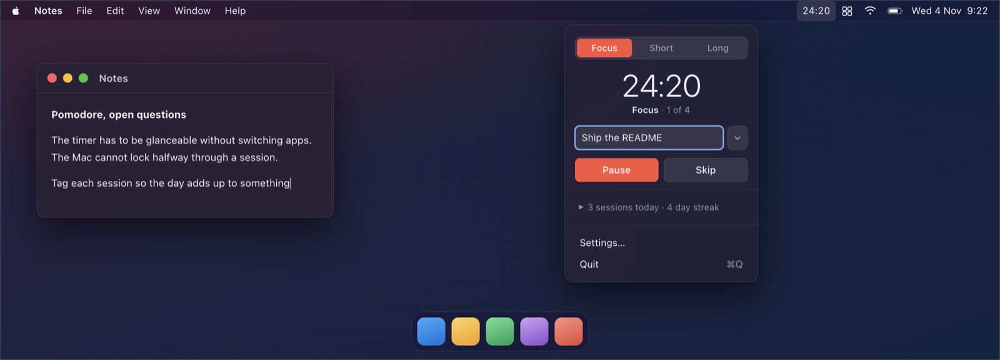
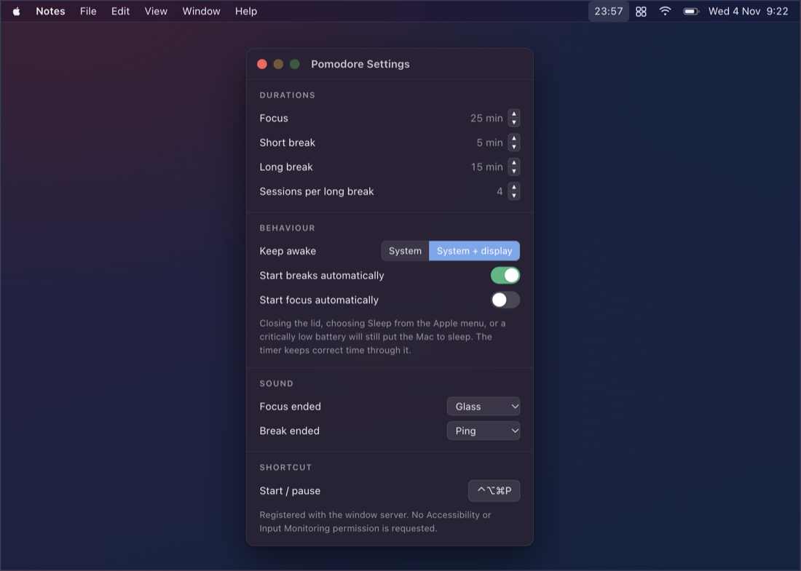
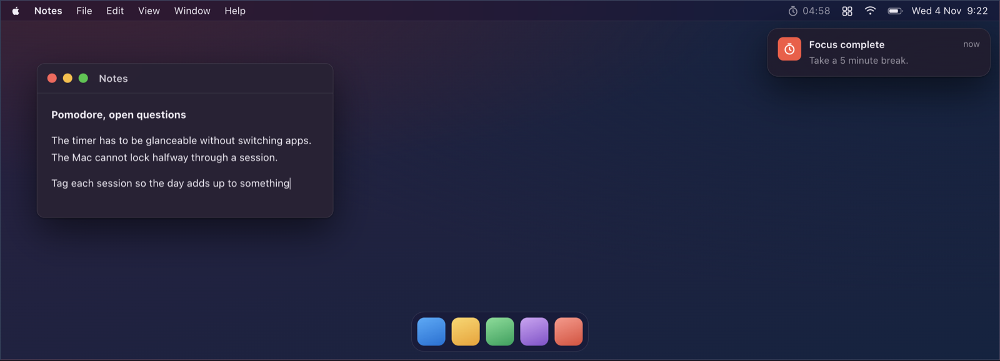

# Pomodore

A menu bar pomodoro timer for macOS that keeps the Mac and the display awake while a
focus session is running.

The remaining time sits in the status area as live `mm:ss` text. Clicking it opens a
popover with the controls. Being `LSUIElement`, the app has no dock icon, no main window,
and no app menu.

Built as a personal tool: no accounts, no sync, no App Store, no sandbox.



The popover carries the phase, the position in the cycle, the tag for the current session,
and today's count. The tag carries over, so repeated work needs no typing.





Images are rendered from the design prototype the app was built to.

## Requirements

- macOS 14 or later (Apple silicon)
- Xcode 16 or later, for the Swift 6 toolchain

## Install

```
./install.sh
```

Builds Release, replaces `/Applications/Pomodore.app`, and launches it. Re-run it to
update. It kills the running copy first, since that copy holds the status item and the
global hotkey registration and would otherwise have its bundle swapped out underneath it.
It refuses to touch an existing `/Applications/Pomodore.app` whose bundle id is not
`com.bisaya.Pomodore`.

After that it is an ordinary app: start it from Spotlight, Launchpad, or
`open -a Pomodore`.

Two things to expect:

- Each rebuild gets a fresh ad-hoc signature and the notification authorization record is
  tied to it, so the first phase transition after an install prompts for permission again.
- There is no launch at login, so a reboot means starting it by hand.

## Build and run from source

```
open Pomodore.xcodeproj     # then Run, or:
xcodebuild -scheme Pomodore -configuration Debug build
./Checks/run.sh             # the checks, a few seconds
```

`Checks/` is not an Xcode test target. It compiles the sources straight with `swiftc`, so
it runs with no scheme, no simulator, and no host app. The `menubar` and `hotkey` checks
drive real AppKit objects, so they need a logged-in GUI session and briefly put an item in
the menu bar.

## What it does

- **Timer.** Focus / short break / long break, driven by an absolute deadline, so it keeps
  honest time through sleep, a lid close, and a display reconnect. Start, pause, resume,
  skip, reset.
- **Wake lock.** Holds off system sleep, and optionally display sleep, for the duration of
  a focus phase only.
- **Alerts.** A banner and a chime at each phase transition.
- **History.** One free-text tag per focus session, carried over between sessions. Today's
  count, the current streak, and today broken down by tag.
- **Global hotkey.** One system-wide chord toggles start/pause. Default
  <kbd>Control</kbd>+<kbd>Option</kbd>+<kbd>Command</kbd>+<kbd>P</kbd>, rebindable in
  settings.

Defaults are 25 / 5 / 15 minutes with a long break every 4th focus session. Durations,
cycle length, sounds, wake lock scope, auto-advance, and the hotkey all live in the
settings window, opened from the popover.

## Quitting

With no dock icon and no app menu, the ways out are the popover's Quit, the status item's
right-click menu, or `pkill -x Pomodore`.

## A note on signing

Release sets `CODE_SIGN_INJECT_BASE_ENTITLEMENTS = NO`, and it is worth knowing why before
removing it. Ad-hoc signing (`CODE_SIGN_IDENTITY = "-"`) makes Xcode inject
`com.apple.security.get-task-allow` into every configuration, Release included. That
entitlement permits `task_for_pid` against the process, so any code running as you can
attach to it, read and write its memory, and inject into it. It cancels most of what
`ENABLE_HARDENED_RUNTIME = YES` is there to buy, in a process that runs all day and holds a
system-wide hotkey registration. Debug keeps it, because the debugger needs it.

Check an installed copy with `codesign -d --entitlements - /Applications/Pomodore.app`: it
should print no entitlements at all, while `codesign -dv` still reports
`flags=0x10002(adhoc,runtime)`.

## License

MIT. See [LICENSE](LICENSE).
